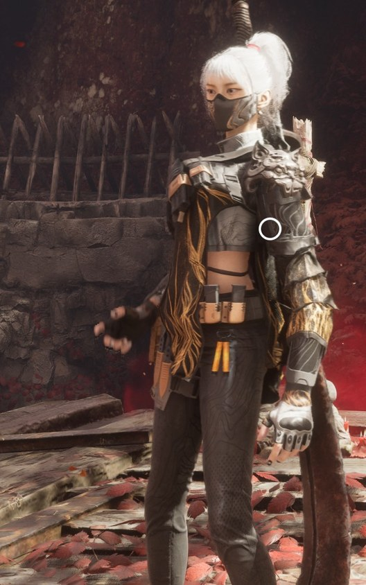
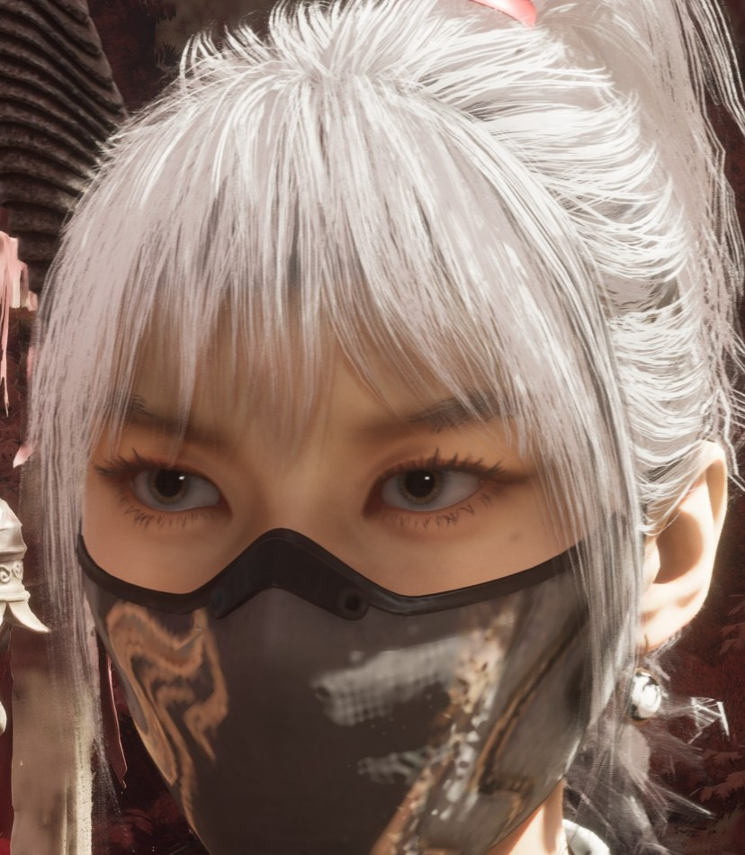

# 影之刃零 × 麦晓雯「水墨云图」MOD

把《影之刃零》主角的外观换成《三角洲行动》麦晓雯（骇爪）的「水墨云图」皮肤，并配上独立的头发与衣物物理、眨眼、眼球转动，以及可选的女声战斗语音。非官方 MOD。

**v1.1** · [下载](https://github.com/Elysia0126/maixiaowen-pbz-mod/releases/tag/v1.1) · [更新记录](CHANGELOG.md) · [验证记录](docs/validation-v1.1.json)

<p>
  
  
</p>

游戏内截图，拍摄于模型调整期间；之后又还原了耳上两侧的黑色发束，左右发束见[离线预览](docs/images/v0.7/side_hair_preview.png)。

## 内容一览

| 部分 | 说明 |
| --- | --- |
| 模型 | 皮肤大厅展示用的高精度模型 |
| 物理 | 马尾、碎发、前后衣摆和袖口共 4 组布料，约 2,300 个动态粒子，F9 开关 |
| 比例与握刀 | 默认整体缩到 90%，F6 可切到主角的正常大小，选择会被记住；手里的刀、刀鞘、特效和攻击判定一起缩放，握刀贴合 |
| 眨眼 | 每 2.5～6.5 秒随机眨一次，偶尔连眨两下，F7 开关 |
| 眼球转动 | 眼球左右上下转动，眼睑和睫毛跟着动，扫视节奏取自主角过场动画，F8 开关 |
| 战斗语音（可选） | 主角的攻击、蓄力、受击、咳嗽和呼吸声换成麦晓雯的女声，单独一个包，可装可不装 |

## 安装

Release 里有两个压缩包：

- `MaixiaowenInk_PBZ_Mod_v1.1.zip`：外观 MOD，必装。
- `MaixiaowenInk_PBZ_VoiceCN_v1.0.zip`：中文战斗语音，可选。

游戏根目录是 Steam 里「管理 → 浏览本地文件」打开的位置。安装前先完全退出游戏。

1. 解压外观包，把 `MOD` 里的 `ProjectPBZ` 和 `platform` 两个文件夹合并复制到游戏根目录。
2. 还没装过 UE4SS 的话，把 `UE4SS_PBZ_Optional` 里的 `platform` 文件夹也合并复制到游戏根目录。已经装过的，保留现有加载器和其他 MOD。
3. 打开 `platform/steam/ue4ss/Mods/mods.txt`，确认里面有一行 `MaixiaowenInk : 1`。已有加载列表的，加上这一行即可，不要整个覆盖。
4. 想要女声战斗语音，就解压语音包，把里面的 `ProjectPBZ` 文件夹合并复制到游戏根目录。游戏的语音语言需要是中文。
5. 启动游戏，读取存档。

装好后的文件：

```text
PBZ/
├─ ProjectPBZ/Content/Paks/~mods/
│  ├─ MaixiaowenInk_P.pak / .utoc / .ucas        外观（必装）
│  └─ MaixiaowenVoiceCN_P.pak / .utoc / .ucas    语音（可选）
└─ platform/steam/ue4ss/Mods/MaixiaowenInk/Scripts/
   └─ main.lua
```

按过 F6 之后，`main.lua` 旁边会多一个 `scale.txt`，记录选的大小。从 v1.0 升级的，旧的 `variant.txt` 已经不用了，可以删掉。

同名的三个资源文件（pak、utoc、ucas）和 `main.lua` 必须来自同一版本，不要混用。每个包里都有 `SHA256.json` 用来校验文件，Release 的 `SHA256SUMS.txt` 用来校验压缩包。

## 按键

| 按键 | 功能 |
| --- | --- |
| F6 | 在 90% 和主角正常大小之间切换，选择保存在 `scale.txt` |
| F7 | 开关眨眼 |
| Shift+F7 | 放一次约 2.5 秒的慢速眨眼，方便看清 |
| F8 | 开关眼球转动 |
| Shift+F8 | 让眼睛依次看左、右、上、下，方便检查 |
| F9 | 开关头发和衣物物理 |
| F10 | 在麦晓雯和原版主角之间切换 |

默认全部开启。另有两个调试键：Shift+F6 重新读取脚本旁边的 `eye_tune.txt`（用于调眼睛材质，没有这个文件就什么都不做），Shift+F5 切换几种近景镜头。

## 各部分是怎么做的

### 模型与材质

- 模型来自《三角洲行动》的麦晓雯「水墨云图」皮肤，用的是皮肤展示界面那套高精度网格和贴图。
- 模型绑定到主角原本的骨架上，显示组件跟随主角的动画骨架运动，所以所有动作、技能和受击都照常播放。
- 皮肤、头发、眼睛、泪膜、眼部阴影都改用《影之刃零》主角自己的原生材质，再换上麦晓雯的贴图，在游戏光照下表现更一致。
- 模型另外做了：脸颊和面罩微调；还原耳上两侧扫向发绳的黑色发束；前摆缩到胯部；后摆给臀部留出间隙；腰间小刀和刀鞘在收纳时向后移 5.8 cm、向下移 1.8 cm（这是 90% 时的距离，正常大小时等比放大）。

### 物理

- 马尾、碎发、前后衣摆和袖口是 4 组 Chaos 布料，由显示模型自己模拟，不影响主角原来的碰撞。
- 调整模型时，有几处布料顶点在动作中会被甩出很远。已经把这些顶点背后的物理三角形固定住，现在模拟时最大位移约 8 cm。

### 比例与握刀

- 麦晓雯比主角矮，所以默认整体缩到 90%。按 F6 可以切回主角的正常大小，再按一次回到 90%；选择保存在脚本旁边的 `scale.txt`，下次启动沿用。
- 缩放加在主角的动画骨架上，而不是只缩显示模型，这样挂在骨架插槽上的刀、刀鞘、特效和攻击判定都一起缩放，换武器、拔刀收刀也始终贴合。
- 代价是 90% 时**攻击判定也一起缩小了，刀的攻击距离短了约 10%**。想要原版的攻击距离，按 F6 切到正常大小。角色的碰撞胶囊在两种大小下都不变。
- 90% 时缩放会让动画自带的位移也变短，脚本把位移倍率调到 1/0.9 抵消了，跑动和突进距离不变；正常大小时不需要补偿。如果游戏自己改了这个倍率，脚本就不再干预。

### 眨眼与眼球转动

- 眨眼靠模型上的 `Blink` 变形：上下眼睑绕眼球中心转到闭合，睫毛跟着走。
- 眼球转动的数据是从主角身上逆向来的。主角的头是 MetaHuman 式的面部绑定，从他的绑定数据（DNA）里可以读出眼球的转动范围（向外约 42°、向内约 38°、上下约 30°），以及眼睑跟着眼球动的比例（往下看时上眼睑跟 91%、下眼睑跟 59%；往上看时分别跟 53% 和 38%）。模型上为每只眼做了左右上下 4 个方向的变形，眼睑和睫毛按这个比例跟随。
- 主角在实际游玩中眼睛是不动的，只有过场动画里才有人工制作的眼神。所以扫视的幅度、停留时间和速度，统计自主角过场动画里的 103 次扫视；较大的扫视有时还会带一次眨眼。

### 战斗语音

- 替换的是主角战斗时的语气声：攻击、蓄力、受击、倒地、咳嗽、呼吸等，共 42 个音效事件、270 段音频。剧情对白不受影响，主角仍是原声。
- 呼吸里有 16 段直接用了她在《三角洲行动》里的真实呼吸录音，按原来的时长和起伏贴合。
- 其余 254 段由 AI 变声生成（其中 11 段带声带振动的呼吸或极短的片段沿用了更早一版的转换）：用她在《三角洲行动》里的 223 秒原声（喘息、受击、喊叫、咳嗽）微调开源变声模型 Seed-VC，再把主角原来的语气声转换成她的音色。每一类都单独按她的同类录音调整了音高和音色，保留原来的时长和节奏。**这些是 AI 生成的声音，不是配音演员的新录音。**
- 新音频按原来的格式重新编码后，写回原文件里对应的位置，文件结构和长度都不变。

## 稳定性

早期版本在 Boss 战中出现过 `UE4SS.dll` 崩溃。原因是 UE4SS 让一个模组的所有线程共用同一个 Lua 虚拟机，异步循环和游戏线程同时运行时会把它破坏。现在全部逻辑只在游戏线程上运行，按键回调只设一个标记，这个问题之后没有再出现过。这个原因是根据 UE4SS 源码和崩溃转储推断的。

## 已经验证的和已知限制

测试环境：Windows、Steam 版、UE 5.7.4。

已在游戏里确认：

- 握刀贴合，90% 和正常大小下日志显示的右手武器挂点误差都是 0.00 cm。
- 模型默认加载，4 组布料物理生效。F6 在两种大小之间往返切换、选择在重启后沿用、F10 恢复原版都正常；正常大小时和原版主角一样高。
- 眨眼、慢速眨眼正常。F8 开关和 Shift+F8 测试中，眼睛左右上下转动正确。
- 战斗语音的替换方式在早期测试版本上实测过：挥刀时播放的是替换后的声音。1.0 的语音包沿用同样的文件结构，已装进作者的游戏，但没有逐个事件在实机里测过，受击类语音也还没有专门测试。

离线已验证：布料模拟没有顶点被甩飞，后摆 1,884 个采样点都没有穿进裤子；眼球和眨眼变形能从动画骨架正确传到显示模型；资源容器校验通过。详细数据见[验证记录](docs/validation-v1.1.json)。

已知限制：

- 90% 时刀的攻击距离短约 10%（见上文），可以按 F6 切到正常大小。
- 正常大小目前只在站立、切换和 F10 往返时看过，跑动、闪避、拔刀和战斗还没有专门测。
- 过场动画用的是另一个角色，所以过场里仍是原版主角的样子和眼神。
- 没有覆盖所有武器、地图、过场、重生和长时间战斗。
- 发片在某些角度可能露缝或穿插；布料没有自碰撞，也不会和武器、场景碰撞。
- 肤色和眼睛的反光受场景光照影响。
- 语音只在中文语音下替换。语音包里带着整份中文语音资源文件（约 250 MB，其中只有主角战斗语气那部分被改过）。如果游戏以后更新中文语音，请先停用语音包，否则可能把官方的新语音盖掉。

## 停用、卸载与回退

- 临时切回原版主角外观：按 F10。只关眨眼：F7。只关眼球转动：F8。
- 停用外观：退出游戏，把 `mods.txt` 里那一行改成 `MaixiaowenInk : 0`。
- 停用语音：退出游戏，删除或移走 `~mods` 里的三个 `MaixiaowenVoiceCN_P` 文件，下次启动就是原声。
- 完全卸载：退出游戏，删除 `~mods` 里本 MOD 的同名文件、`Mods/MaixiaowenInk` 文件夹和 `mods.txt` 里那一行。其他 MOD 和游戏文件都不用动。
- 回退旧版：退出游戏，用旧版压缩包里的三个资源文件和 `main.lua` 一起覆盖，不要只换其中一部分。旧版本都在 [Releases](https://github.com/Elysia0126/maixiaowen-pbz-mod/releases)。

## 角色设定参考

[官方角色资料页](https://www.playdeltaforce.com/act/wikimap/)可以确认骇爪 / 麦晓雯的身份，但官网上没有找到能核实的身高。第三方数据库列出的 [164 cm](https://deltaforce.th.gl/db/operators/op_88000000026) 只作比例参考；90% 是本 MOD 自己定的视觉比例。

## 仓库内容

- `src/main.lua`：发布用的 UE4SS 脚本。
- `docs/`：截图、各版本验证记录和发布包信息。
- `THIRD_PARTY/`：第三方许可证。

编译好的模型、贴图、语音和可选的 UE4SS 加载器都在 Releases 里。仓库没有包含完整的 Unreal 工程，也没有一键重建流程。

## 许可与致谢

角色、模型、贴图和语音素材来自《三角洲行动》的麦晓雯「水墨云图」；《影之刃零》的原始资源、角色、美术和商标权利均归原权利人所有。本项目是非官方的爱好者作品，与两款游戏的开发商和发行商都没有关系，也不对任何第三方素材授予额外许可。

- 可选加载器：[UE4SS（KintaroModding 分支）](https://github.com/KintaroModding/ue4ss)，MIT 许可，许可证见包内和 `THIRD_PARTY/UE4SS-LICENSE`。这份许可不适用于角色、美术等第三方素材。
- 语音制作时用到（均未随本 MOD 分发）：[Seed-VC](https://github.com/Plachta/Seed-VC)（GPL-3.0）、OpenVoice V2、BigVGAN、RMVPE、CAMPPlus 等模型，以及 vgmstream。
- 资源提取与打包：CUE4Parse、retoc。
