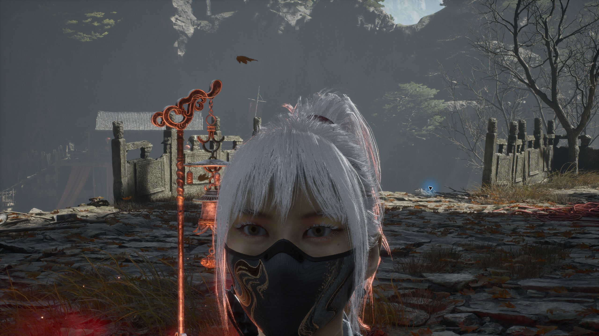
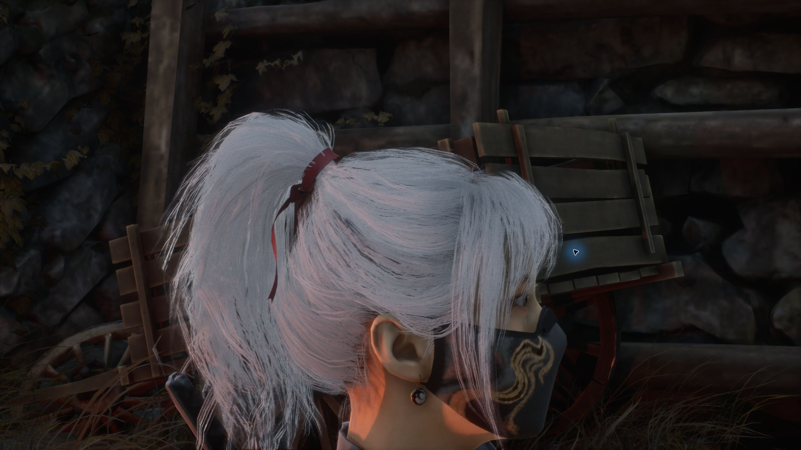

# 影之刃零 × 麦晓雯「水墨云图」MOD

将《影之刃零》主角外观替换为麦晓雯「水墨云图」，支持头发与衣物独立物理。非官方 MOD。

**v0.5 为试验版**：[下载 v0.5](https://github.com/Elysia0126/maixiaowen-pbz-mod/releases/tag/v0.5) · [保留的 v0.4](https://github.com/Elysia0126/maixiaowen-pbz-mod/releases/tag/v0.4) · [更新记录](CHANGELOG.md) · [v0.5 验证记录](docs/validation-v0.5.json)





## v0.5 内容

- 显示模型整体缩小到 v0.4 的 90%，缓解原男主身架偏大的观感。原动画驱动骨架、移动与碰撞体尺寸保留；这不是逐骨重塑，也不是精确官方身高复原。
- 补齐替换网格的 10 根武器挂点骨骼和 12 个插槽，将已捕获的背部武器组件随显示模型挂接。
- 眼睛增加轻微瞳孔位移与大小变化，可用 F8 关闭；保留 v0.4 的虹膜、眼白及湿润高光。未增加眨眼、眼睑或注视目标动画。
- 增加银灰头皮底色，略微提高原发片透明贴图的覆盖，减少稀疏角度露出黄色头皮。保留发丝轮廓与耳部肤色。
- 保留 v0.4 肤色匹配、固定头皮发片，以及 4 组头发和衣物物理。
- **语音未替换，仍为游戏原声。** 已定位短促挥剑发声事件，但未完成合成、导入与播放验证；包内不含新语音。

## 安装

1. 下载 `MaixiaowenInk_PBZ_Mod_v0.5.zip` 并解压。
2. 退出游戏，将包内 `MOD` 的 `ProjectPBZ` 和 `platform` 两个文件夹合并复制到 PBZ 游戏根目录。
3. 尚未安装 UE4SS 时，将 `UE4SS_PBZ_Optional` 中的 `platform` 文件夹也合并复制到游戏根目录。已有加载器时保留加载器、其他 MOD 和加载列表。
4. 确认 `platform/steam/ue4ss/Mods/mods.txt` 包含 `MaixiaowenInk : 1`。已有加载列表请添加此条目，避免覆盖其他 MOD。
5. 启动游戏，加载已有存档。

游戏根目录是 Steam「管理 → 浏览本地文件」打开的位置。

```text
PBZ/
├─ ProjectPBZ/Content/Paks/~mods/
│  ├─ MaixiaowenInk_P.pak
│  ├─ MaixiaowenInk_P.utoc
│  └─ MaixiaowenInk_P.ucas
└─ platform/steam/ue4ss/Mods/MaixiaowenInk/Scripts/main.lua
```

三种资源文件与 `main.lua` 必须一起更新，不能混用 v0.4/v0.5。包内 `SHA256.json` 校验各文件；Release 的 `SHA256SUMS.txt` 校验压缩包。

## 按键

| 按键 | 功能 |
| --- | --- |
| F8 | 开启/关闭轻微瞳孔动态 |
| F9 | 开启/关闭头发与衣物独立物理 |
| F10 | 在替换形象与原版主角之间切换 |

默认三项均开启。发布脚本不包含临时检查镜头及全场景诊断按键。

## 验证范围与已知限制

本地环境：Windows、Steam 构建 `301524-17219`、UE 5.7.4、地图 `B02/PBZ_Xigu_WP`。已进行多角度近看、普通挥剑、握持和背部挂点检查、F8/F9/F10 关闭与恢复，以及发布脚本重启。详细结果以验证记录为准。

试验期间，加入临时全场景诊断后发生过一次 UE4SS 内部访问异常，准确原因未确定。移除该诊断后重新完成超过 10 分钟的基础操作复测，未再次出现该异常。发布脚本已去掉全部临时诊断和镜头功能。此结果不证明长期战斗或所有场景均稳定，因此 v0.5 以试验版提供，v0.4 保留下载。

未覆盖所有武器、地图、过场、重生和长期战斗。缩小显示模型不改变原角色的命中体积；特殊动作、其他武器可能仍有握持偏移。发片仍可能在掠射角度有缝隙或穿插，未重建为逐根毛发。布料不具备衣物自碰撞、武器或场景碰撞。肤色与眼睛高光受光照影响。

## 角色设定参考

[官方角色资料页](https://www.playdeltaforce.com/act/wikimap/)可确认 Hackclaw / 麦晓雯身份；本次未在官网找到可核实的身高。第三方数据库所列的 [164 cm](https://deltaforce.th.gl/db/operators/op_88000000026) 仅作比例参考，不能标为官方确认数据。90% 为本 MOD 的视觉调整值。

## 停用、卸载与回退

- 临时恢复原版：F10。只关闭眼睛动态：F8。
- 永久停用：退出游戏，将加载列表中的条目改为 `MaixiaowenInk : 0`。
- 卸载：退出游戏，移除本 MOD 三种同名资源、`Mods/MaixiaowenInk` 文件夹及加载条目，保留其他 MOD 和原游戏文件。
- 回退 v0.4：退出游戏，用 v0.4 包的三种资源和 `main.lua` 一起覆盖 v0.5。不要只替换脚本或单个资源。

## 仓库与许可

`src/main.lua` 是发布脚本；`docs/` 提供截图、验证记录及包信息。编译资源与可选加载器位于 Releases，仓库未提供完整 Unreal 工程或一键重建流程。

角色、网格与原始贴图来源于《三角洲行动》的麦晓雯「水墨云图」；相关游戏、角色、美术和商标权利归原权利人。本项目为非官方适配，与原开发者、发行商无关联，未对第三方素材授予额外许可。

可选加载器来自 [KintaroModding/ue4ss](https://github.com/KintaroModding/ue4ss)，适用 MIT 许可，原许可证见包内及 `THIRD_PARTY/UE4SS-LICENSE`。该许可不适用于游戏角色、美术等第三方资源。
