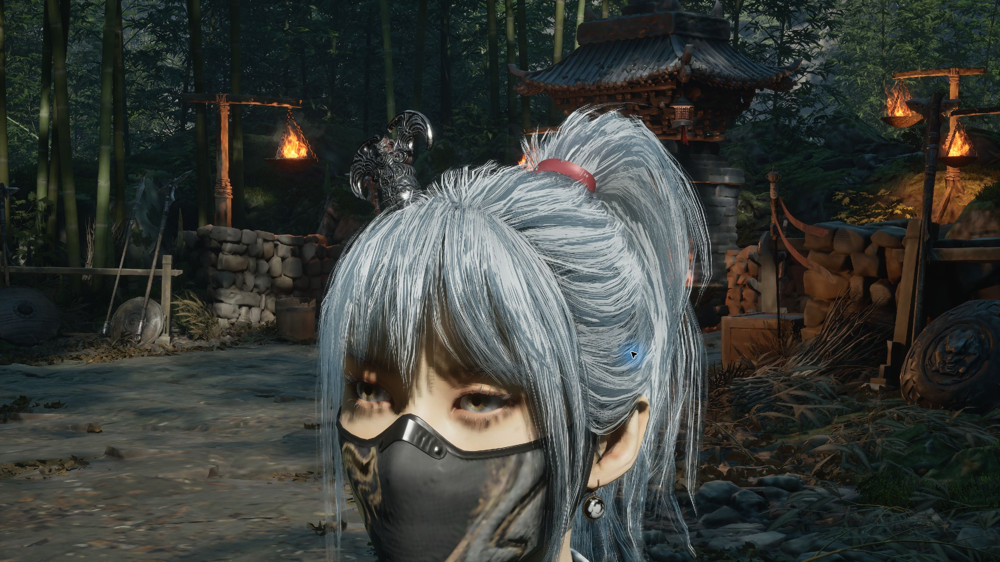
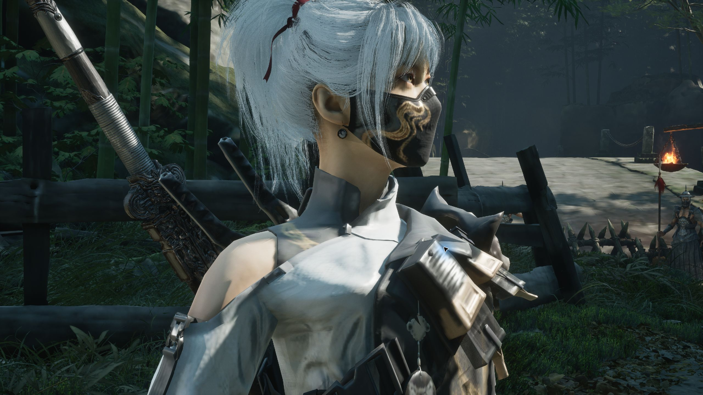

# 影之刃零 × 麦晓雯「水墨云图」MOD

将《影之刃零》主角外观替换为麦晓雯「水墨云图」，支持头发与衣物独立物理。当前版本 **v0.4**，为非官方角色替换 MOD。

[下载安装包](https://github.com/Elysia0126/maixiaowen-pbz-mod/releases/latest) · [v0.4 更新记录](CHANGELOG.md) · [验证记录](docs/validation-v0.4.json)





## v0.4 内容

- 校正脸部偏红、偏暗的底色，缩小脸、脖子与身体的肤色差异。
- 增加脸部专用遮蔽、粗糙度和金属度贴图，调整皮肤反光。
- 调整虹膜、瞳孔比例、眼白和湿润高光，改善眼睛层次。
- 保留 v0.3 发丝细节、头皮发片固定，以及马尾、袖口与衣摆独立物理。

## 安装

1. 从 [Releases](https://github.com/Elysia0126/maixiaowen-pbz-mod/releases) 下载 `MaixiaowenInk_PBZ_Mod_v0.4.zip` 并解压。
2. 退出游戏。将包内 `MOD` 文件夹中的 `ProjectPBZ` 与 `platform` 两个文件夹合并复制到 PBZ 游戏根目录。
3. 如果尚未安装 UE4SS，将 `UE4SS_PBZ_Optional` 中的 `platform` 文件夹也合并复制到游戏根目录。已有 UE4SS 时请保留现有加载器、其他 MOD 和加载列表。
4. 确认 `platform/steam/ue4ss/Mods/mods.txt` 包含 `MaixiaowenInk : 1`。包内可选加载器已附带该条目；现有加载器请自行添加，避免覆盖其他 MOD 条目。
5. 启动游戏，加载已有存档。

游戏根目录是 Steam「管理 → 浏览本地文件」打开的位置，示例：`E:/SteamLibrary/steamapps/common/PBZ`。

安装后的主要文件：

```text
PBZ/
├─ ProjectPBZ/Content/Paks/~mods/
│  ├─ MaixiaowenInk_P.pak
│  ├─ MaixiaowenInk_P.utoc
│  └─ MaixiaowenInk_P.ucas
└─ platform/steam/ue4ss/Mods/MaixiaowenInk/Scripts/main.lua
```

三种资源文件及 `main.lua` 必须使用同一版本。安装包内提供 `SHA256.json`；Releases 另附整个压缩包的 `SHA256SUMS.txt`。

## 按键

| 按键 | 功能 |
| --- | --- |
| F9 | 开启/关闭头发与衣物独立物理 |
| F10 | 在替换形象与原版主角之间切换 |

默认启用替换形象与独立物理。正式脚本不包含临时检查镜头按键。

## 验证范围与已知限制

本地测试环境：Windows、Steam《影之刃零》构建 `301524-17219`，UE 5.7.4，地图 `B02/PBZ_Xigu_WP`。其他构建或游戏更新后需要重新验证。

已检查正面、两侧与背面近景、脸颈肩同框、F9/F10 切换和正式脚本重启。新增两张皮肤贴图为 2048×2048，打包解码后与输入图一致；网格、骨骼和物理数据与 v0.3 相同。物理为 4 组布料、2422 个活动顶点。

尚未覆盖所有地图、光照、过场、重生及长时间战斗。肤色仍受光照与阴影影响。头发使用发片局部物理，复杂动作可能穿插，未实现衣物自碰撞、武器或场景碰撞。眼睛改善来自材质参数，未新增眨眼或注视动画。自动瞳孔漂移实验首次测试发生崩溃后已移除，具体原因尚未确定；移除后的基础检查未再出现该问题。

## 停用、卸载与回退

- 临时恢复原版：按 F10。
- 永久停用：退出游戏，将 `Mods/mods.txt` 中本 MOD 的条目改为 `MaixiaowenInk : 0`。
- 卸载：退出游戏，移除 `~mods` 中本 MOD 的三种同名资源、`Mods/MaixiaowenInk` 文件夹和对应加载条目。保留其他 MOD、原始游戏文件及存档。
- 回退：退出游戏，用自行备份的旧版本三种资源及 `main.lua` 一起覆盖。

## 仓库内容

`src/main.lua` 为本版本运行脚本；`docs/` 提供截图和验证记录。编译后的网格、贴图、物理资源与可选加载器在 Releases 安装包中。本仓库未提供完整 Unreal 工程或一键重建流程。

## 来源与许可说明

角色、网格和原始贴图来源于《三角洲行动》的麦晓雯「水墨云图」；《影之刃零》及《三角洲行动》相关美术、角色和商标权利归各原权利人。此项目为非官方适配，与原游戏开发者或发行商无关联；本仓库未对第三方素材授予额外许可。

可选加载器来自 [KintaroModding/ue4ss](https://github.com/KintaroModding/ue4ss)，适用 MIT 许可，原许可证保存在安装包与 `THIRD_PARTY/UE4SS-LICENSE`。UE4SS 的许可不适用于游戏角色、美术或其他第三方资源。
